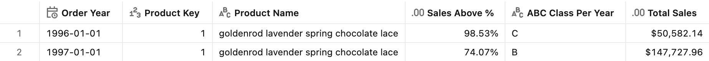
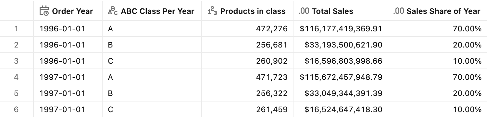
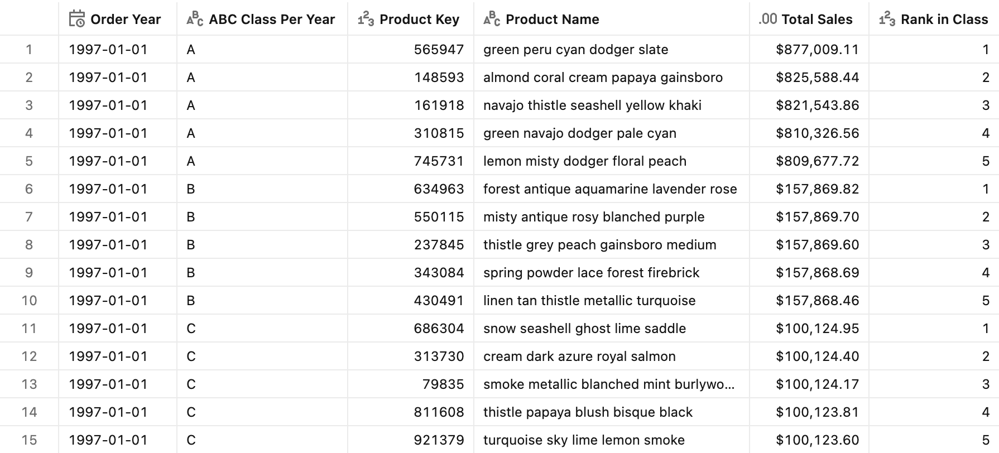
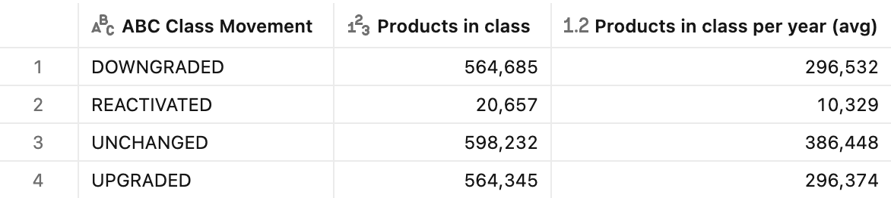
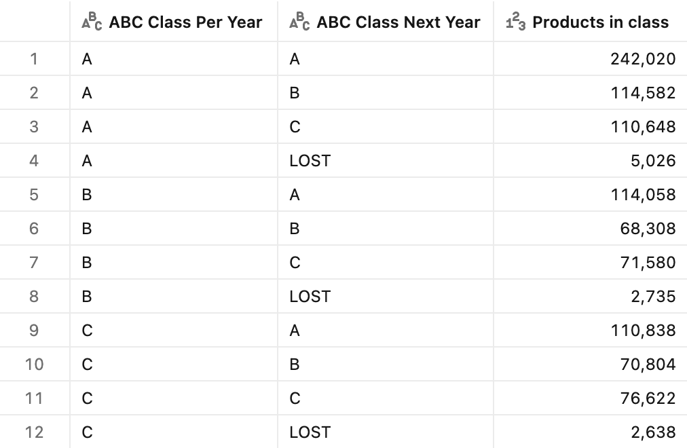
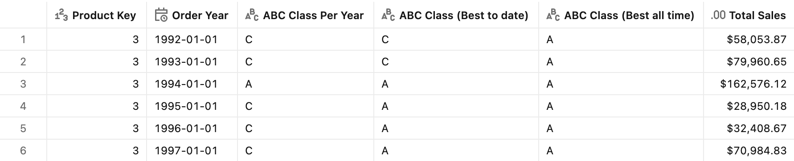
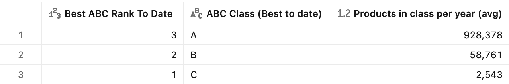
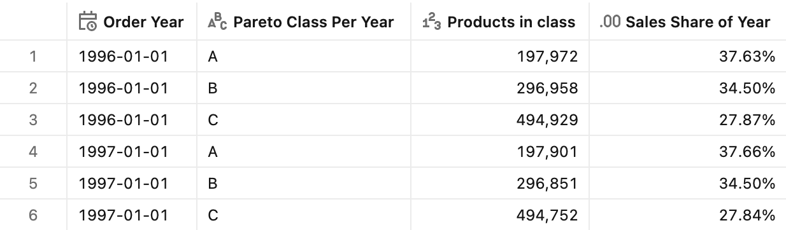

# :abc: ABC classification

## Introduction

ABC classification answers the "where should we focus?" question by ranking entities on how much they contribute to a total. It rests on the **Pareto principle**: a small share of entities usually drives most of the value. A typical example is **inventory and assortment management**: products are sorted from the biggest contributor to the smallest, their share of total sales is accumulated down the list, and the list is cut into three classes:

- **Class A** — the top products that together make up the first **70%** of sales. They get the tightest stock control, the most frequent review, and the highest service level.
- **Class B** — the next products that together reach **90%** of sales.
- **Class C** — the long tail that makes up the last **10%**. These are candidates for simpler replenishment rules or for delisting.

The ABC classification pattern is a special case of [Dynamic segmentation](../Dynamic%20segmentation/) and is built on the same principles, using the [Fixed level of detail](https://docs.databricks.com/aws/en/uc-semantics/metric-views/level-of-detail#fixed-level-of-detail) capability: the class is *not* stored on a row; it is derived from the product's sales, aggregated with window expressions over fixed dimensions (`ProductKey`, `Year`), relative to all other products. The cut is re-run for every year, so a product might belong to different classes in different years.

- **This year's class** — classify every product as A / B / C by its share of *this year's* sales, and see how many products each class holds.
- **Rank within class** — rank products inside their class to find the top products of class A and the class B products closest to dropping to class C.
- **Class movement** — label products by how their class changed versus last year (upgraded, downgraded, unchanged, new, or reactivated), and see which products are lost the year after.
- **Best class** — give each product the **best class it has reached so far**, or over all years.
- **Pareto by product count** — classify by *share of products* (the top 20%) instead of share of sales.


## Preparation

1. Ensure that you have created the test dataset using the [tpc-h.sql](/tpc-h.sql) script.

2. Create the basic metric view definition. The source is the `lineitem` table, so every row is one order line of one product. Sales are the TPC-H net revenue, `l_extendedprice * (1 - l_discount)`.
    <details>
    <summary>Basic metric view definition</summary>

    ```yaml
    version: 1.1
    comment: Unity Catalog semantics patterns

    source: lineitem

    joins:
      - name: orders
        source: orders
        'on': source.l_orderkey = orders.o_orderkey
        rely:
          at_most_one_match: true
        joins:
          - name: customer
            source: customer
            'on': orders.o_custkey = customer.c_custkey
            rely:
              at_most_one_match: true
            joins:
              - name: nation
                source: nation
                'on': customer.c_nationkey = nation.n_nationkey
                rely:
                  at_most_one_match: true
                joins:
                  - name: region
                    source: region
                    'on': nation.n_regionkey = region.r_regionkey
                    rely:
                      at_most_one_match: true

      - name: part
        source: part
        'on': source.l_partkey = part.p_partkey
        rely:
          at_most_one_match: true

    fields:
      - name: RegionName
        display_name: Region Name
        expr: orders.customer.nation.region.r_name

      - name: CountryName
        display_name: Country Name
        expr: orders.customer.nation.n_name

      - name: ProductKey
        display_name: Product Key
        expr: l_partkey

      - name: ProductName
        display_name: Product Name
        expr: part.p_name

      - name: Brand
        display_name: Brand
        expr: part.p_brand

      - name: ProductType
        display_name: Product Type
        expr: part.p_type

      - name: OrderDate
        display_name: Order Date
        expr: orders.o_orderdate
        format:
          type: date
          date_format: year_month_day
          leading_zeros: true

      - name: Year
        display_name: Order Year
        expr: "DATE_TRUNC('year', orders.o_orderdate)"
        format:
          type: date
          date_format: year_month_day
          leading_zeros: true

      - name: Month
        display_name: Order Month
        expr: "DATE_TRUNC('month', orders.o_orderdate)"
        format:
          type: date
          date_format: year_month_day
          leading_zeros: true

      - name: Quarter
        display_name: Order Quarter
        expr: "DATE_TRUNC('quarter', orders.o_orderdate)"
        format:
          type: date
          date_format: year_month_day
          leading_zeros: true

      - name: NetSales
        display_name: Net Sales
        comment: Line revenue after discount
        expr: l_extendedprice * (1 - l_discount)
        format:
          type: currency
          currency_code: USD
          decimal_places:
            type: exact
            places: 2
          hide_group_separator: false
          abbreviation: none

    measures:
      - name: TotalSales
        display_name: Total Sales
        comment: Net sales (extended price after discount) across all order lines in the period
        expr: SUM(NetSales)
        format:
          type: currency
          currency_code: USD
          decimal_places:
            type: exact
            places: 2
          hide_group_separator: false
          abbreviation: none

      - name: QuantitySold
        display_name: Quantity Sold
        comment: Units sold across all order lines in the period
        expr: SUM(l_quantity)
        format:
          type: number
          decimal_places:
            type: all
          hide_group_separator: false
          abbreviation: none
    ```

    </details>

Some general concepts applied for all patterns below: 
- Products are identified by `ProductKey`. Every window partitions by the key, not by `ProductName`, because TPC-H part names are generated and are not guaranteed to be unique.
- Window expressions in `fields:` are [**fixed level of detail**](https://docs.databricks.com/aws/en/uc-semantics/metric-views/level-of-detail#filtering-on-fixed-level-of-detail-expressions) expressions: they are computed *before* the query's `WHERE` filters. Filtering on `Year`, `Brand`, or `ProductKey` therefore does **not** re-run the Pareto cut over the surviving rows. A product keeps the class earned against *all* products of that year. This is what makes the class stable and comparable across dashboard tabs. To classify within a narrower population (for example, within each brand), add that field to the `PARTITION BY` of the windows.

> [!IMPORTANT]
> **Partial years.** TPC-H orders end on 1998-08-02, so 1998 holds only seven months of sales. In real data, the latest year is usually incomplete too. Within a partial year, the classes are still consistent, because every product is compared over the same months. Comparing a partial year with a full one is misleading, though: products that mostly sell late in the year look DOWNGRADED, and every product without sales in the months loaded so far shows up as LOST in the previous year's `ABCClassNextYear`. The test queries therefore use the full years **1996 and 1997**. In production, classify on rolling 12-month periods counted back from the latest order date, compare the same months of each year, or flag incomplete years so users do not read them as full ones.

> [!TIP]
> The class dimensions are a chain of window expressions over the whole `lineitem` table, and they are computed before the query's filters. Every query therefore evaluates the full chain, whatever it filters on. On TPC-H this is fine. On a large production fact table behind a dashboard, consider precomputing the per-product, per-year class upstream (for example, in a scheduled job) and joining it to the metric view as a dimension, the same way the [configuration table](../Static%20segmentation/#segments-from-a-configuration-table) is joined in the Static segmentation patterns.


## ABC class by yearly sales

**Sample question** - *Which products make up the first 70% of this year's sales (class A), the next 20% (B), and the long tail (C)? How many products are in each class?*

The logic sums the product's sales within the year (`ProductTotal`), then walks the order lines from the biggest product to the smallest. `SUM(NetSales) OVER (PARTITION BY Year ORDER BY ProductTotal DESC)` is the running total of sales of all products whose yearly total is at or above the current product's total. Subtracting the sales of the current product (and of any product tied with it) gives the sales held by the products **above** it, and dividing by the year's total (`YearTotal`) turns it into a `0`–`1` share (`SalesAbovePct`). A `CASE` assigns the class at the **70% / 90%** cutoffs.

| Class | Sales share held by the products above |
|-------|----------------------------------------|
| A     | < 70%                                  |
| B     | ≥ 70% and < 90%                        |
| C     | ≥ 90%                                  |

The class is tested on the share of sales held by the products **above** the current one, not on the share *including* it. With the rule `CumulativeSalesPct <= 0.7`, a product that holds more than 70% of the year's sales on its own would land in class B and leave class A **empty**. This is common when one product dominates, or when the cut runs within a small population such as one brand. Testing the share above puts the product that crosses the 70% line into class A. The top product is therefore always A, and class A holds slightly more than 70% of sales. `CumulativeSalesPct` (the share including the product) is kept for display.

> [!NOTE]
> The 70% / 90% thresholds are the conventional ABC boundaries, fixed in the `CASE`. To let the business own them, keep the thresholds in a **configuration table** joined to the metric view, as in [Segments from a configuration table](../Static%20segmentation/#segments-from-a-configuration-table). For a dashboard experience where users try their own cutoffs, expose them as **parameters** (for example, `p_class_a_threshold` with `default: 0.7`), as in the [Currency conversion](../Currency%20conversion/#single-source-currency-multiple-targets) patterns.

### Measure definition

```yaml
# fields:
- name: ProductTotal
  display_name: Product Total
  expr: SUM(NetSales) OVER (PARTITION BY ProductKey, `Year`)
  format:
    type: currency
    currency_code: USD
    decimal_places:
      type: exact
      places: 2
    hide_group_separator: false
    abbreviation: none

- name: YearTotal
  display_name: Year Total
  expr: SUM(NetSales) OVER (PARTITION BY `Year`)
  format:
    type: currency
    currency_code: USD
    decimal_places:
      type: exact
      places: 2
    hide_group_separator: false
    abbreviation: none

- name: CumulativeSalesPct
  display_name: Cumulative Sales %
  comment: Running share of the year's sales from the top product down to and including the current product
  expr: SUM(NetSales) OVER (PARTITION BY `Year` ORDER BY ProductTotal DESC) / YearTotal
  format:
    type: percentage
    decimal_places:
      type: exact
      places: 2
    hide_group_separator: false

- name: SalesAbovePct
  display_name: Sales Above %
  comment: Share of the year's sales held by the products ranked above the current product (ties excluded)
  expr: >-
    (SUM(NetSales) OVER (PARTITION BY `Year` ORDER BY ProductTotal DESC)
     - SUM(NetSales) OVER (PARTITION BY `Year`, ProductTotal))
    / YearTotal
  format:
    type: percentage
    decimal_places:
      type: exact
      places: 2
    hide_group_separator: false

- name: ABCClassPerYear
  display_name: ABC Class Per Year
  expr: >-
    CASE
      WHEN SalesAbovePct<0.7 THEN 'A'
      WHEN SalesAbovePct<0.9 THEN 'B'
      ELSE 'C'
    END

# measures:
- name: SalesShareOfYear
  display_name: Sales Share of Year
  comment: Share of the year's total sales; NULL when the result row spans more than one year
  expr: >-
    CASE
      WHEN COUNT(DISTINCT `Year`) = 1 THEN SUM(NetSales) / ANY_VALUE(YearTotal)
    END
  format:
    type: percentage
    decimal_places:
      type: exact
      places: 2
    hide_group_separator: false

- name: Count_class
  display_name: Products in class
  comment: Counts the number of distinct products in the class
  expr: COUNT(DISTINCT ProductKey)
  format:
    type: number
    decimal_places:
      type: all
    hide_group_separator: false
    abbreviation: none
```

The windows ordered by `ProductTotal` have no explicit frame, so they use the default `RANGE BETWEEN UNBOUNDED PRECEDING AND CURRENT ROW`. All lines of products with the same yearly total fall into the same frame, and `SUM(NetSales) OVER (PARTITION BY Year, ProductTotal)` is exactly the sales of that tie group. Every line of a product therefore gets the same share, and tied products land in the same class.

> [!WARNING]
> `SalesShareOfYear` divides by one year's total, so it only makes sense when every result row belongs to a single year. If `Year` is missing from the `GROUP BY` and the query spans several years, the measure returns `NULL` instead of a misleading share.

### Test query

```sql
SELECT
    `Year`,
    ProductKey,
    ProductName,
    SalesAbovePct,
    ABCClassPerYear,
    AGG(TotalSales)
FROM mv_ABCClassification
WHERE (`Year` = '1997-01-01' OR `Year` = '1996-01-01') AND ProductKey = 1
GROUP BY ALL
ORDER BY `Year`
```

 The `ProductKey` filter follows a single product's class across years. Because the class is computed before filters, the product still keeps the class earned against all products.

<details>
<summary>Test query output</summary>



</details>

To size the classes, group by the class dimension and count the products. `SalesShareOfYear` confirms the Pareto cut: class A holds roughly 70% of the year's sales.

> [!NOTE]
> TPC-H is a synthetic dataset with sales spread almost evenly across products, so the Pareto effect is weak: class A holds about half of all products, and the top 20% of products hold under 40% of sales (see [Pareto by product count](#pareto-by-product-count)). Classes also change a lot from one year to the next. The test queries show how the pattern works, not a realistic concentration. In real assortments, a small share of products (often around 20%) typically makes up class A.

```sql
SELECT
    `Year`,
    ABCClassPerYear,
    AGG(Count_class),
    AGG(TotalSales),
    AGG(SalesShareOfYear)
FROM mv_ABCClassification
WHERE (`Year` = '1997-01-01' OR `Year` = '1996-01-01')
GROUP BY ALL
ORDER BY `Year`, ABCClassPerYear
```

<details>
<summary>Test query output</summary>



</details>

> [!TIP]
> To classify products on their **all-time** sales instead of a single year, remove `Year` from the `PARTITION BY` of `ProductTotal`, `YearTotal`, `CumulativeSalesPct`, and `SalesAbovePct`.


## Rank within ABC class

**Sample question** - *Which are the top 5 products in each class this year, and which class B products are closest to dropping to class C?*

The class tells you *which group* a product belongs to, but not *where* the product sits inside it. Combine the class dimension with a dynamic ranking measure from the [Ranking](../Ranking/) patterns: `RANK()` over the query-time `SUM(NetSales)`, with `ABCClassPerYear` added to the `PARTITION BY`, so the rank restarts at `1` within every class and year. 
Swap `RANK()` for any other function from [Ranking](../Ranking/) (`DENSE_RANK()`, `ROW_NUMBER()`, `PERCENT_RANK()`) to change how ties and positions are reported. Order `ASC` to rank from the bottom of the class, for example to find the class B products closest to dropping to class C.

`RankInClass` is a measure, so it follows the [Ranking](../Ranking/) rules: every field in its `PARTITION BY` (`Year` and `ABCClassPerYear`) must be in the `GROUP BY`, and the rank is recomputed for the query's filters. The class itself is a dimension computed before filters. Filtering on `Brand` therefore ranks the brand's products within their class, while every product keeps the class earned against all products.

### Measure definition

```yaml
# measures:
- name: RankInClass
  display_name: Rank in class
  comment: Position of the product by sales within its ABC class and year; requires Year and ABCClassPerYear in the GROUP BY
  expr: RANK() OVER (PARTITION BY `Year`, ABCClassPerYear ORDER BY SUM(NetSales) DESC)
  format:
    type: number
    decimal_places:
      type: all
    hide_group_separator: false
    abbreviation: none
```

### Test query

```sql
SELECT *
FROM (
    SELECT
        `Year`,
        ABCClassPerYear,
        ProductKey,
        ProductName,
        AGG(TotalSales) AS TotalSales,
        AGG(RankInClass) AS RankInClass
    FROM mv_ABCClassification
    WHERE `Year` = '1997-01-01'
    GROUP BY ALL
)
WHERE RankInClass <= 5
ORDER BY ABCClassPerYear, RankInClass
```

<details>
<summary>Test query output</summary>



</details>


## ABC class movement

**Sample question** - *Which products were upgraded or downgraded between classes versus last year? Which products are new, which came back, and which did we lose?*

Instead of the class itself, you can group products by how their class **moves year over year**. Rank the classes (A = 3, B = 2, C = 1), pull the prior year's rank with a time-based window, and compare:

| Movement    | Rule                                                                        |
|-------------|-----------------------------------------------------------------------------|
| UPGRADED    | The class rank went up versus the prior year                                |
| DOWNGRADED  | The class rank went down versus the prior year                              |
| UNCHANGED   | The class is the same as in the prior year                                  |
| NEW         | No sales in the prior year, and this is the product's first year with sales |
| REACTIVATED | No sales in the prior year, but the product sold in an earlier year         |

> [!IMPORTANT]
> A product that stops selling has **no rows** in the year it is lost, so a movement label computed in that year can never show it, and the most important signal for the business silently disappears. Likewise, a product that skips a year and comes back is not NEW, so the label separates NEW from REACTIVATED using the product's first year with sales.

The pattern therefore also looks one year **ahead**: `ABCClassNextYear` is the class the product reaches next year, or `LOST` when it has no sales next year. Grouping by this year's class and next year's class gives a **class migration matrix** — for example, *"Of last year's class A products, how many stayed A, dropped to B or C, or were lost?"*

### Measure definition

```yaml
# fields:
- name: ABCClassRank
  display_name: ABC Class Rank
  comment: ABC class rank based on the year's sales
  expr: >-
    CASE
      WHEN ABCClassPerYear = 'A' THEN 3
      WHEN ABCClassPerYear = 'B' THEN 2
      ELSE 1
    END

- name: ABCClassRank_PY
  display_name: ABC Class Rank PY
  expr: MAX(ABCClassRank) OVER (PARTITION BY ProductKey ORDER BY `Year` RANGE BETWEEN INTERVAL 1 YEAR PRECEDING AND INTERVAL 1 YEAR PRECEDING)

- name: FirstSalesYear
  display_name: First Sales Year
  expr: MIN(`Year`) OVER (PARTITION BY ProductKey)
  format:
    type: date
    date_format: year_month_day
    leading_zeros: true

- name: ABCClassMovement
  display_name: ABC Class Movement
  expr: >-
    CASE
      WHEN ABCClassRank_PY IS NULL AND `Year` = FirstSalesYear THEN 'NEW'
      WHEN ABCClassRank_PY IS NULL THEN 'REACTIVATED'
      WHEN ABCClassRank>ABCClassRank_PY THEN 'UPGRADED'
      WHEN ABCClassRank<ABCClassRank_PY THEN 'DOWNGRADED'
      ELSE 'UNCHANGED'
    END

- name: ABCClassRank_NY
  display_name: ABC Class Rank NY
  expr: MAX(ABCClassRank) OVER (PARTITION BY ProductKey ORDER BY `Year` RANGE BETWEEN INTERVAL 1 YEAR FOLLOWING AND INTERVAL 1 YEAR FOLLOWING)

- name: LastDataYear
  display_name: Last Data Year
  expr: MAX(`Year`) OVER ()
  format:
    type: date
    date_format: year_month_day
    leading_zeros: true

- name: ABCClassNextYear
  display_name: ABC Class Next Year
  expr: >-
    CASE
      WHEN `Year` = LastDataYear THEN NULL
      WHEN ABCClassRank_NY = 3 THEN 'A'
      WHEN ABCClassRank_NY = 2 THEN 'B'
      WHEN ABCClassRank_NY = 1 THEN 'C'
      ELSE 'LOST'
    END

# measures:
- name: Count_class_per_year
  display_name: Products in class per year (avg)
  comment: Product-years in the class divided by the number of years in the query, so years without any product in the class count as zero
  expr: COUNT(DISTINCT ProductKey, `Year`) / MAX(COUNT(DISTINCT `Year`)) OVER ()
  format:
    type: number
    decimal_places:
      type: exact
      places: 0
    hide_group_separator: false
    abbreviation: none
```

`FirstSalesYear` and `LastDataYear` are bounded by the data you loaded. In the first year of data every product is NEW, and in the last year `ABCClassNextYear` is `NULL` because the next year is not known yet.

### Test query

```sql
SELECT
    ABCClassMovement,
    AGG(Count_class),
    AGG(Count_class_per_year)
FROM mv_ABCClassification
WHERE (`Year` = '1997-01-01' OR `Year` = '1996-01-01')
GROUP BY ALL
ORDER BY ABCClassMovement
```

When the query covers several years (as in the example) and `Year` is not in the GROUP BY, you also have to decide how the per-year counts combine across years. Each choice answers a different business question:
- **Distinct across years**: *"How many products were downgraded in at least one year over 1996–1997?"* As in `AGG(Count_class)`, each product is counted only once per movement label for the whole period.
- **Average per year**: *"How many products are downgraded in a typical year?"* as in `AGG(Count_class_per_year)`. It counts product-years with the label and divides by the number of years in the query, so a year in which no product carries the label counts as zero.

> [!WARNING]
> Averaging per-year counts with `partition: {include: [Year], outer_aggregate: avg}` (as in the [Dynamic segmentation](../Dynamic%20segmentation/) patterns) only averages the years in which the label **exists**. If DOWNGRADED occurs in 1997 but not in 1996, the "typical year" becomes the 1997 count instead of half of it, which inflates rare labels such as DOWNGRADED, NEW, or LOST. `Count_class_per_year` divides by `MAX(COUNT(DISTINCT Year)) OVER ()`, the number of years in the query result, instead. This assumes that at least one group in the result spans all selected years, which holds when grouping by class or movement.

<details>
<summary>Test query output</summary>



</details>

 Add `Year` to the query to see the split over years. Because the prior-year window is computed before filters, 1996 still compares against 1995 even though 1995 is filtered out.

The class migration matrix shows where last year's classes went:

```sql
SELECT
    ABCClassPerYear,
    ABCClassNextYear,
    AGG(Count_class)
FROM mv_ABCClassification
WHERE `Year` = '1996-01-01'
GROUP BY ALL
ORDER BY ABCClassPerYear, ABCClassNextYear
```

<details>
<summary>Test query output</summary>



</details>


## Best ABC class

**Sample question** - *What is the best class each product has reached so far, and how many products hold each best class?*

The yearly class can move from one year to the next. When you need a single, more stable class per product, keep the **best class the product has achieved**. Take the maximum class rank per product with a window, then map it back to a label. There are two variants, and the difference matters for historical analysis:

- **Best to date** (`ABCClassBestToDate`) — the best class reached **up to and including** the year in view. Looking at 1995, it only uses 1995 and earlier years. Use this for any trend or historical view.
- **Best all time** (`ABCClassBestAllTime`) — the best class over **all** years in the data, the same no matter the year in view. Looking at 1995, it already reflects what happened in 1997, so do not use it to explain the past. It suits a current master-data attribute (*"has this product ever been an A item?"*).

> [!IMPORTANT]
> `MAX(ABCClassRank) OVER (PARTITION BY ProductKey)` without an `ORDER BY` looks at every year in the data, including years *after* the one in view. Trends built on it look ahead: a product appears as a past A item only because it became A later. Use `ABCClassBestToDate` whenever the year matters.

### Measure definition

```yaml
# fields:
- name: BestABCRankToDate
  display_name: Best ABC rank to date
  expr: MAX(ABCClassRank) OVER (PARTITION BY ProductKey ORDER BY `Year`)

- name: ABCClassBestToDate
  display_name: ABC class (best to date)
  expr: >-
    CASE
      WHEN BestABCRankToDate = 3 THEN 'A'
      WHEN BestABCRankToDate = 2 THEN 'B'
      ELSE 'C'
    END

- name: BestABCRankAllTime
  display_name: Best ABC rank all time
  expr: MAX(ABCClassRank) OVER (PARTITION BY ProductKey)

- name: ABCClassBestAllTime
  display_name: ABC class (best all time)
  expr: >-
    CASE
      WHEN BestABCRankAllTime = 3 THEN 'A'
      WHEN BestABCRankAllTime = 2 THEN 'B'
      ELSE 'C'
    END
```

`BestABCRankToDate` orders by `Year` without an explicit frame, so it uses the default `RANGE BETWEEN UNBOUNDED PRECEDING AND CURRENT ROW`: all lines of the current year and of every earlier year.

### Test query

```sql
SELECT
    ProductKey,
    `Year`,
    ABCClassPerYear,
    ABCClassBestToDate,
    ABCClassBestAllTime,
    AGG(TotalSales)
FROM mv_ABCClassification
WHERE ProductKey = 3
GROUP BY ALL
ORDER BY `Year`
```

<details>
<summary>Test query output</summary>



</details>

The best class to date can only stay the same or improve over time, while the best all-time class never changes.

To size each best class across several years, `Count_class_per_year` counts the products per class in each year and averages over the years in the query. This answers the question *"In a typical year, how many of our selling products have been class A at some point so far?"*

```sql
SELECT
    BestABCRankToDate,
    ABCClassBestToDate,
    AGG(Count_class_per_year)
FROM mv_ABCClassification
WHERE (`Year` = '1997-01-01' OR `Year` = '1996-01-01')
GROUP BY ALL
ORDER BY BestABCRankToDate DESC
```

<details>
<summary>Test query output</summary>



</details>

## Pareto by product count

**Sample question** - *Rather than the products making up 70% of sales, which products are simply in the top 20% of products by sales this year?*

Value-based ABC classifies by *share of sales*. Sometimes the business classifies by *share of products* instead — "the top 20% of products". Each row of the source is an order line, so a running `COUNT` would count lines, not products. To count each product once, only the product's first line in the year is flagged with `1`. The running sum of the flag, ordered by `ProductTotal`, is the number of products at or above the current one. As in the value-based class, the class is based on the share of products ranked **above** the current one (`ProductsAbovePct`), so the top product is always in class A.

| Class | Share of products ranked above |
|-------|--------------------------------|
| A     | < 20% (top 20%)                |
| B     | ≥ 20% and < 50% (next 30%)     |
| C     | ≥ 50% (bottom 50%)             |


Value-based ABC (*which products make up 70% of sales*) and count-based Pareto (*the top 20% of products*) answer different questions. Pick the one that matches how the business defines a class.

`CUME_DIST()` is not used here on purpose. In `fields:` the window runs over order lines, so `CUME_DIST() OVER (PARTITION BY Year ORDER BY ProductTotal DESC)` returns the share of **lines**, not products: a product with many lines pushes every product below it further down the distribution. `CUME_DIST()` gives the right answer only when every row is one product, for example in a measure evaluated after `GROUP BY ProductKey`. The class then becomes a measure, which you cannot group by or count.

### Measure definition

```yaml
# fields:
- name: ProductFirstLineFlag
  display_name: Product First Line Flag
  expr: CASE WHEN ROW_NUMBER() OVER (PARTITION BY ProductKey, `Year` ORDER BY l_orderkey, l_linenumber) = 1 THEN 1 ELSE 0 END

- name: CumulativeProductPct
  display_name: Cumulative Product %
  comment: Share of the year's products with sales greater than or equal to the current product
  expr: >-
    SUM(ProductFirstLineFlag) OVER (PARTITION BY `Year` ORDER BY ProductTotal DESC)
    / SUM(ProductFirstLineFlag) OVER (PARTITION BY `Year`)
  format:
    type: percentage
    decimal_places:
      type: exact
      places: 2
    hide_group_separator: false

- name: ProductsAbovePct
  display_name: Products Above %
  comment: Share of the year's products ranked above the current product (ties excluded)
  expr: >-
    (SUM(ProductFirstLineFlag) OVER (PARTITION BY `Year` ORDER BY ProductTotal DESC)
     - SUM(ProductFirstLineFlag) OVER (PARTITION BY `Year`, ProductTotal))
    / SUM(ProductFirstLineFlag) OVER (PARTITION BY `Year`)
  format:
    type: percentage
    decimal_places:
      type: exact
      places: 2
    hide_group_separator: false

- name: ParetoClassPerYear
  display_name: Pareto Class Per Year
  expr: >-
    CASE
      WHEN ProductsAbovePct<0.2 THEN 'A'
      WHEN ProductsAbovePct<0.5 THEN 'B'
      ELSE 'C'
    END
```

### Test query

```sql
SELECT
    `Year`,
    ParetoClassPerYear,
    AGG(Count_class),
    AGG(SalesShareOfYear)
FROM mv_ABCClassification
WHERE (`Year` = '1997-01-01' OR `Year` = '1996-01-01')
GROUP BY ALL
ORDER BY `Year`, ParetoClassPerYear
```

<details>
<summary>Test query output</summary>



</details>

> [!TIP]
> Group by `ABCClassPerYear` and `ParetoClassPerYear` together to compare the two definitions side by side.


## End-to-end template

The end-to-end reference implementation can be found in the [ABC_classification.yml](./ABC_classification.yml) file.
