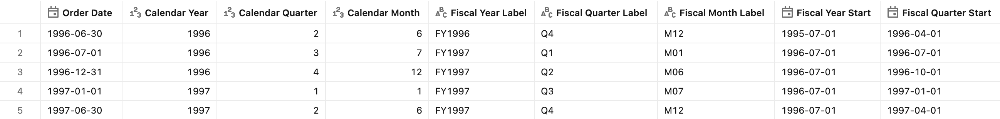
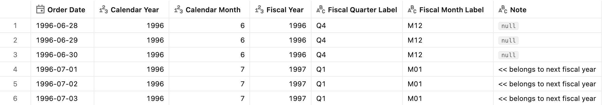
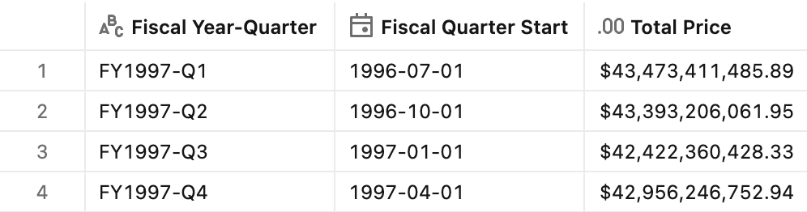

# :moneybag: Fiscal Calendar (month-based)

## Introduction

Many organizations run their budget and reporting on a **fiscal year** that doesn't start on January 1 — governments, universities, and companies whose business is seasonal often start it in April, July, or October. Reporting on calendar quarters then cuts across the planning cycle:

- **Targets and budgets are set per fiscal period.** Comparing actuals to plan only works when actuals are grouped by the same fiscal year, quarter, and month.
- **Fiscal Q1 is not calendar Q1.** With a July start, fiscal Q1 is July–September, so "Q1 results" mean different months on the two calendars.
- **Year-over-year compares whole fiscal years.** FY2025 vs. FY2024 must cover July–June on both sides, not January–December.

A **fiscal calendar** keeps the ordinary Gregorian months and days, and only **shifts the start of the year**. In this pattern, the fiscal year starts on **July 1** and is labelled by the calendar year in which it **ends**: July 2024 – June 2025 is **FY2025**. Fiscal quarters (Q1–Q4) and fiscal months (M01–M12) are counted from the start month.

This pattern derives the full fiscal calendar **inline** from a single date column. For when to keep the calendar in the metric view versus a calendar table, see [Calendars](../README.md).

## Preparation

1. Ensure that you have created the test dataset using the [tpc-h.sql](/tpc-h.sql) script.

2. Create the basic metric view definition
    <details>
    <summary>Basic metric view definition</summary>

    ```yaml
    version: 1.1
    comment: Unity Catalog semantics patterns - Fiscal (month-based) calendar

    source: orders

    joins:
      - name: customer
        source: customer
        'on': source.o_custkey = customer.c_custkey
        rely:
          at_most_one_match: true
        joins:
          - name: nation
            source: nation
            'on': customer.c_nationkey = nation.n_nationkey
            rely:
              at_most_one_match: true
            joins:
              - name: region
                source: region
                'on': nation.n_regionkey = region.r_regionkey
                rely:
                  at_most_one_match: true

    fields:
      - name: RegionName
        display_name: Region Name
        expr: customer.nation.region.r_name

      - name: CountryName
        display_name: Country Name
        expr: customer.nation.n_name

      - name: CustomerName
        display_name: Customer Name
        expr: customer.c_name

      - name: MarketSegment
        display_name: Market Segment
        expr: customer.c_mktsegment

      - name: OrderDate
        display_name: Order Date
        expr: o_orderdate
        format:
          type: date
          date_format: year_month_day
          leading_zeros: true

      - name: OrderPriority
        display_name: Order Priority
        expr: o_orderpriority

      - name: ShipPriority
        display_name: Ship Priority
        expr: o_shippriority

    measures:
      - name: TotalPrice
        display_name: Total Price
        comment: Total Price across all orders in the period
        expr: SUM(o_totalprice)
        format:
          type: currency
          currency_code: USD
          decimal_places:
            type: exact
            places: 2
          hide_group_separator: false
          abbreviation: none
    ```

    </details>

## Fiscal calendar fields

The fiscal calendar fields are **layered**: each field references the earlier ones by name, starting from the `OrderDate` field rather than the raw column, so pointing the calendar at another date (or casting a timestamp to a date) is a one-line change in `OrderDate`. It is also required for correct results when you group [window measures by a date hierarchy field](https://docs.databricks.com/aws/en/uc-semantics/metric-views/advanced-techniques#group-by-a-date-hierarchy-field), as in the Time Intelligence patterns. A single helper shifts the order date forward by the number of months between the fiscal start month and January, so that the fiscal year lines up with a calendar year. The fiscal year, quarter, and month are then read from the shifted date with the standard `year()`, `quarter()`, and `month()` functions.

> [!NOTE]
> With a July start, the order date is shifted by **6 months**: July 1, 1996 becomes January 1, 1997, so it falls in FY1997, Q1, M01. Only the year, quarter, and month of the shifted date are used, so month-end dates (e.g. Aug 31 shifted to Feb 28) are not a problem.

> [!TIP]
> To use another start month *S*, change the shift in `_FiscalShiftedDate` and the `-6` in `FiscalYearStart` and `FiscalQuarterStart` to `(13 - S) % 12` months: 3 for an October start, 9 for an April start. If your organization labels the fiscal year by its **start** year instead (e.g. April 2024 – March 2025 = FY2024), subtract 1 in `FiscalYear` when the start month is not January.

### Field definition

```yaml
  - name: _FiscalShiftedDate
    display_name: Fiscal Shifted Date
    comment: Internal helper - order date shifted so that the fiscal start month (July) lands on January. For another start month S use (13 - S) % 12 months
    expr: add_months(`OrderDate`, 6)

  - name: FiscalYear
    display_name: Fiscal Year
    comment: Fiscal year number, labelled by the calendar year in which the fiscal year ends (Jul 2024 - Jun 2025 = 2025)
    expr: year(`_FiscalShiftedDate`)

  - name: FiscalQuarter
    display_name: Fiscal Quarter
    comment: Fiscal quarter 1..4 (Q1 = Jul-Sep)
    expr: quarter(`_FiscalShiftedDate`)

  - name: FiscalMonth
    display_name: Fiscal Month
    comment: Fiscal month 1..12 (1 = July)
    expr: month(`_FiscalShiftedDate`)

  - name: FiscalYearStart
    display_name: Fiscal Year Start
    comment: First day of the fiscal year containing the order date
    expr: add_months(trunc(`_FiscalShiftedDate`, 'YEAR'), -6)
    format:
      type: date
      date_format: year_month_day
      leading_zeros: true

  - name: FiscalQuarterStart
    display_name: Fiscal Quarter Start
    comment: First day of the fiscal quarter containing the order date
    expr: add_months(trunc(`_FiscalShiftedDate`, 'QUARTER'), -6)
    format:
      type: date
      date_format: year_month_day
      leading_zeros: true

  - name: FiscalYearLabel
    display_name: Fiscal Year Label
    comment: Fiscal year label, e.g. FY2025
    expr: concat('FY', `FiscalYear`)

  - name: FiscalQuarterLabel
    display_name: Fiscal Quarter Label
    comment: Quarter label, e.g. Q1..Q4
    expr: concat('Q', `FiscalQuarter`)

  - name: FiscalMonthLabel
    display_name: Fiscal Month Label
    comment: Zero-padded fiscal month label, e.g. M01..M12
    expr: concat('M', lpad(`FiscalMonth`, 2, '0'))

  - name: FiscalYearQuarter
    display_name: Fiscal Year-Quarter
    comment: Sortable year+quarter key, e.g. FY2025-Q1
    expr: concat('FY', `FiscalYear`, '-Q', `FiscalQuarter`)

  - name: FiscalYearMonth
    display_name: Fiscal Year-Month
    comment: Sortable year+month key, e.g. FY2025-M01
    expr: concat('FY', `FiscalYear`, '-M', lpad(`FiscalMonth`, 2, '0'))
```

Not every field is used in the examples below. `FiscalQuarter` and `FiscalMonth` are numeric keys for sorting and filtering, and the labels are built from them. `FiscalYearMonth` is a sortable key for monthly trends across several fiscal years.

### Test query

> [!NOTE]
> The Gregorian grains in the test queries are derived on the fly from `OrderDate` purely for contrast — they are **not** stored fields. If you expect them alongside the Fiscal Calendar fields, add them as separate fields.

```sql
SELECT
  OrderDate,
  -- Gregorian grains
  year(OrderDate)    AS `Calendar Year`,
  quarter(OrderDate) AS `Calendar Quarter`,
  month(OrderDate)   AS `Calendar Month`,
  -- Fiscal (month-based) grains
  FiscalYearLabel,
  FiscalQuarterLabel,
  FiscalMonthLabel,
  FiscalYearStart,
  FiscalQuarterStart
FROM mv_FiscalCalendar
WHERE OrderDate IN (DATE '1996-06-30', DATE '1996-07-01', DATE '1996-12-31', DATE '1997-01-01', DATE '1997-06-30')
GROUP BY ALL
ORDER BY OrderDate
```

<details>
<summary>Test query output</summary>



</details> 


## Where the fiscal year turns over

**Sample question** - *Which fiscal year, quarter, and month does a given order date fall in, and how does that differ from the ordinary calendar?*

**Why it matters** - The fiscal year does **not** turn over on January 1. With a July start, it flips on **July 1**, so from that day on, orders already count towards the *next* fiscal year label. Getting this boundary right is what makes fiscal year-over-year and plan-vs-actual comparisons cover the same months.

### Test query

```sql
SELECT
  OrderDate,
  year(OrderDate)  AS `Calendar Year`,
  month(OrderDate) AS `Calendar Month`,
  FiscalYear,
  FiscalQuarterLabel,
  FiscalMonthLabel,
  CASE WHEN year(OrderDate) <> FiscalYear THEN '<< belongs to next fiscal year' END AS `Note`
FROM mv_FiscalCalendar
WHERE OrderDate BETWEEN DATE '1996-06-28' AND DATE '1996-07-03'
GROUP BY ALL
ORDER BY OrderDate
```

The fiscal year rolls over on **July 1, 1996**: June 30 is the last day of FY1996 (Q4, M12), and July 1 is the first day of FY1997 (Q1, M01), although both dates are in calendar year 1996.

<details>
<summary>Test query output</summary>



</details>

## Sales by fiscal quarter

**Sample question** - *What are total sales per fiscal quarter of FY1997, and on which date does each quarter start?*

**Why it matters** - This is the headline financial report: actuals per fiscal quarter, ready to compare with the budget. `FiscalQuarterStart` shows where each quarter begins, so it is clear that fiscal Q1 of FY1997 starts on July 1, 1996.

### Test query

```sql
SELECT
  FiscalYearQuarter,
  FiscalQuarterStart,
  AGG(TotalPrice)
FROM mv_FiscalCalendar
WHERE FiscalYear = 1997
GROUP BY ALL
ORDER BY FiscalYearQuarter
```

<details>
<summary>Test query output</summary>



</details>


## Next steps

The fiscal fields plug into the [Time Intelligence](../../Time%20Intelligence/) patterns. Use the date-typed fields as the window `order` keys instead of the calendar ones: `FiscalYearStart` instead of `Year` and `FiscalQuarterStart` instead of `Quarter`. For example:
- [Period-to-date totals](../../Time%20Intelligence/Period-to-date%20totals/): fiscal year-to-date (FYTD) and quarter-to-date sales
- [Period-over-period growth](../../Time%20Intelligence/Period-over-period%20growth/): fiscal year-over-year growth, e.g. FY1997 vs. FY1996, with `offset: -1 year` on `FiscalYearStart`
- [Period-to-date growth](../../Time%20Intelligence/Period-to-date%20growth/): FYTD this year vs. the same point in the previous fiscal year

## End-to-end template

The complete, deployable reference implementation is in the [Fiscal Calendar.yml](./Fiscal%20Calendar.yml) file.
