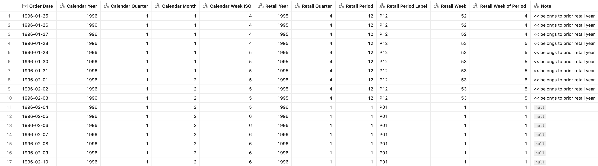
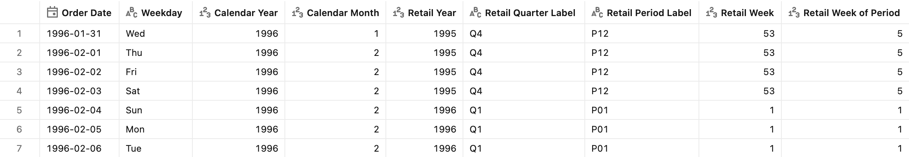
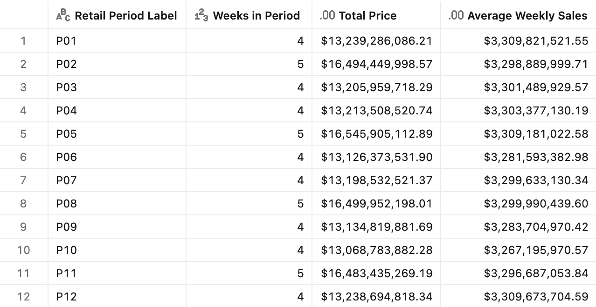
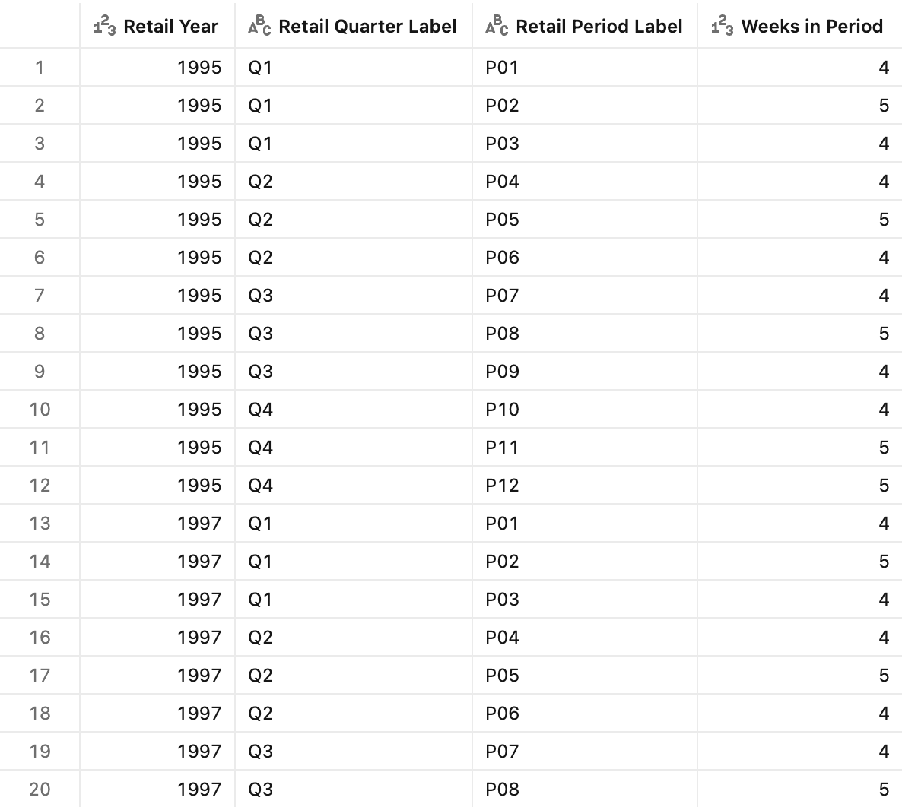

# :shopping_cart: Retail Calendar (4-5-4)

## Introduction

Retail sales are **weekly-seasonal** — weekends spike, weekdays dip — so a fair comparison must hold the number of Saturdays and trading days constant. The Gregorian calendar can't do that:

- **Calendar months are not comparable.** February has 28 days, March has 31; one month may contain 4 weekends and the next 5. A "month-over-month" swing is polluted by that structural difference, not real demand.
- **Retail periods *are* comparable.** A 4-week period always has exactly 4 of each weekday; a 5-week period always 5. Period-over-period and quarter-over-quarter differences reflect the business, not the calendar.
- **Year-over-year lines up on the same selling weeks.** Retail *week 1* of this year matches *week 1* of last year (same weekdays, same position relative to holidays). Anchoring to Jan 1 instead would shift the weekday every year and split the holiday weeks differently.
- **It matches how retailers actually plan and report.** Merchandising, targets, and comps are set on fiscal periods (P01–P12) and 13-week quarters — this pattern speaks that language directly.

A **retail calendar** (a.k.a. *4-5-4* or week-based fiscal calendar) replaces the ragged Gregorian months with fiscal periods built from **whole weeks**. It is the [National Retail Federation (NRF) 4-5-4 standard](https://nrf.com/resources/4-5-4-calendar): the retail year is divided into four 13-week quarters, and each quarter into three "periods" (the retail equivalent of months) of **4, 5, and 4 weeks**. Weeks run **Sunday–Saturday**, and the retail year begins on the **Sunday nearest to February 1**.

This pattern derives the full retail calendar **inline** from a single date column, so no separate calendar table is needed. Put the calendar in the metric view once, and every dashboard, Genie space, and SQL consumer inherits the same governed retail grains.

For the general guidance — when to keep the calendar in the metric view versus a calendar table, and which other calendar types exist — see [Calendars](../README.md).

## Preparation

1. Ensure that you have created the test dataset using the [tpc-h.sql](/tpc-h.sql) script.

2. Create the basic metric view definition
    <details>
    <summary>Basic metric view definition</summary>

    ```yaml
    version: 1.1
    comment: Unity Catalog semantics patterns - Retail (NRF 4-5-4) calendar

    source: orders

    joins:
      - name: customer
        source: customer
        'on': source.o_custkey = customer.c_custkey
        rely:
          at_most_one_match: true
        joins:
          - name: nation
            source: nation
            'on': customer.c_nationkey = nation.n_nationkey
            rely:
              at_most_one_match: true
            joins:
              - name: region
                source: region
                'on': nation.n_regionkey = region.r_regionkey
                rely:
                  at_most_one_match: true

    fields:
      - name: RegionName
        display_name: Region Name
        expr: customer.nation.region.r_name

      - name: CountryName
        display_name: Country Name
        expr: customer.nation.n_name

      - name: CustomerName
        display_name: Customer Name
        expr: customer.c_name

      - name: MarketSegment
        display_name: Market Segment
        expr: customer.c_mktsegment

      - name: OrderDate
        display_name: Order Date
        expr: o_orderdate
        format:
          type: date
          date_format: year_month_day
          leading_zeros: true

      - name: OrderPriority
        display_name: Order Priority
        expr: o_orderpriority

      - name: ShipPriority
        display_name: Ship Priority
        expr: o_shippriority

    measures:
      - name: TotalPrice
        display_name: Total Price
        comment: Total Price across all orders in the period
        expr: SUM(o_totalprice)
        format:
          type: currency
          currency_code: USD
          decimal_places:
            type: exact
            places: 2
          hide_group_separator: false
          abbreviation: none
    ```

    </details>
  

## Retail calendar fields

The retail calendar fields are **layered**: each field references the earlier ones by name, so the block reads top-to-bottom like a derivation, starting from the fiscal-year anchor and ending at the labels and week start date. The chain starts from the `OrderDate` field rather than the raw column, so pointing the calendar at another date (or casting a timestamp to a date) is a one-line change in `OrderDate`. It is also required for correct results when you group [window measures by a date hierarchy field](https://docs.databricks.com/aws/en/uc-semantics/metric-views/advanced-techniques#group-by-a-date-hierarchy-field), as in the Time Intelligence patterns.

> [!NOTE]
> The retail year starts on the **Sunday nearest to Feb 1**. The "nearest-Sunday" trick shifts Feb 1 forward 3 days, then floors back to the Sunday on/before it. A date belongs to retail year *Y* when it is on/after *Y*'s anchor, otherwise to *Y-1*.

> [!TIP]
> To adapt the pattern to the other calendar types listed in [Calendars](../README.md):
> - **4-4-5 / 5-4-4**: change the week thresholds in `RetailPeriodInQuarter` and the offsets in `RetailWeekOfPeriod` (4-4-5: 4 and 8; 5-4-4: 5 and 9).
> - **13-period (4-4-4)**: replace the quarter-based period fields with `RetailPeriod = least(floor((RetailWeek - 1) / 4) + 1, 13)` and `RetailWeekOfPeriod = RetailWeek - (RetailPeriod - 1) * 4`. The 53rd week stays in period 13.
> - **Different year end**: change the anchor date in `_FiscalAnchorCurrent` and `_FiscalAnchorPrior`. For a "last Saturday of the month" year end, floor the month's last day to Saturday instead of using the +3-day nearest-Sunday shift, and start the year on the day after it.
> - **ISO 8601 week date**: Monday-based weeks need no anchor fields. The ISO week is `weekofyear(OrderDate)` and the ISO year is the year of that week's Thursday: `year(date_add(OrderDate, 3 - weekday(OrderDate)))`.
> - **Broadcast calendar**: a broadcast week (Mon–Sun) belongs to the month of its Sunday, so the broadcast year and month are `year()` and `month()` of `date_add(OrderDate, 6 - weekday(OrderDate))`.

### Field definition

```yaml
# Helpers: candidate anchor Sundays (nearest Feb 1) for the order date's calendar year and the previous one

  - name: _FiscalAnchorCurrent
    display_name: Fiscal Anchor (Current Cal Year)
    comment: Internal helper - Sunday nearest Feb 1 of the order date's calendar year
    expr: date_sub(date_add(make_date(year(`OrderDate`), 2, 1), 3), dayofweek(date_add(make_date(year(`OrderDate`), 2, 1), 3)) - 1)

  - name: _FiscalAnchorPrior
    display_name: Fiscal Anchor (Prior Cal Year)
    comment: Internal helper - Sunday nearest Feb 1 of the previous calendar year
    expr: date_sub(date_add(make_date(year(`OrderDate`) - 1, 2, 1), 3), dayofweek(date_add(make_date(year(`OrderDate`) - 1, 2, 1), 3)) - 1)

  - name: RetailYearStart
    display_name: Retail Year Start
    comment: First day (Sunday) of the NRF retail year containing the order date
    expr: CASE WHEN `OrderDate` >= `_FiscalAnchorCurrent` THEN `_FiscalAnchorCurrent` ELSE `_FiscalAnchorPrior` END
    format:
      type: date
      date_format: year_month_day
      leading_zeros: true

  - name: RetailYear
    display_name: Retail Year
    comment: NRF fiscal year label (the year in which the retail year begins)
    expr: year(`RetailYearStart`)

  - name: RetailDayOfYear
    display_name: Retail Day of Year
    comment: 0-based day offset from the retail year start
    expr: datediff(`OrderDate`, `RetailYearStart`)

  - name: RetailWeek
    display_name: Retail Week
    comment: Retail week number 1..52 (53 in a 53-week year)
    expr: floor(`RetailDayOfYear` / 7) + 1

  - name: RetailQuarter
    display_name: Retail Quarter
    comment: Retail quarter 1..4 (13 weeks each, the 53rd week stays in Q4)
    expr: least(floor((`RetailWeek` - 1) / 13) + 1, 4)

  - name: RetailWeekInQuarter
    display_name: Retail Week in Quarter
    comment: Week position within the quarter, 1..13 (14 in the 53rd week)
    expr: "`RetailWeek` - (`RetailQuarter` - 1) * 13"

  - name: RetailPeriodInQuarter
    display_name: Retail Period in Quarter
    comment: 4-5-4 grouping - month position within the quarter (1..3)
    expr: CASE WHEN `RetailWeekInQuarter` <= 4 THEN 1 WHEN `RetailWeekInQuarter` <= 9 THEN 2 ELSE 3 END

  - name: RetailPeriod
    display_name: Retail Period
    comment: Retail period / month number 1..12
    expr: (`RetailQuarter` - 1) * 3 + `RetailPeriodInQuarter`

  - name: RetailWeekOfPeriod
    display_name: Retail Week of Period
    comment: Week position within the retail period (1..5)
    expr: CASE `RetailPeriodInQuarter` WHEN 1 THEN `RetailWeekInQuarter` WHEN 2 THEN `RetailWeekInQuarter` - 4 ELSE `RetailWeekInQuarter` - 9 END

  - name: RetailPeriodLabel
    display_name: Retail Period Label
    comment: Zero-padded period label, e.g. P01..P12
    expr: concat('P', lpad(`RetailPeriod`, 2, '0'))

  - name: RetailQuarterLabel
    display_name: Retail Quarter Label
    comment: Quarter label, e.g. Q1..Q4
    expr: concat('Q', `RetailQuarter`)

  - name: RetailYearPeriod
    display_name: Retail Year-Period
    comment: Sortable year+period key, e.g. 2024-P07
    expr: concat(`RetailYear`, '-P', lpad(`RetailPeriod`, 2, '0'))

  - name: RetailWeekStartDate
    display_name: Retail Week Start Date
    comment: Sunday that begins the retail week
    expr: date_add(`RetailYearStart`, CAST((`RetailWeek` - 1) * 7 AS INT))
    format:
      type: date
      date_format: year_month_day
      leading_zeros: true

```

Not every field is used in the examples below. `RetailDayOfYear` is an intermediate step for `RetailWeek`. `RetailWeekStartDate` is the date key behind the `WeekCount` measure, weekly trend charts, and the window calculations in [Next steps](#next-steps). `RetailYearPeriod` is a sortable key for period trends across several retail years.

### Test query

> [!NOTE]
> The Gregorian grains in the test queries are derived on the fly from `OrderDate` purely for contrast — they are **not** stored fields. If you expect them alongside the Retail Calendar fields, add them as separate fields.

```sql
SELECT
  OrderDate,
  -- Gregorian grains
  year(OrderDate)                  AS `Calendar Year`,
  quarter(OrderDate)               AS `Calendar Quarter`,
  month(OrderDate)                 AS `Calendar Month`,
  weekofyear(OrderDate)            AS `Calendar Week ISO`,   -- ISO week (Mon-based)
  -- Retail (NRF 4-5-4) grains
  RetailYear,
  RetailQuarter,
  RetailPeriod,
  RetailPeriodLabel,
  RetailWeek,
  RetailWeekOfPeriod,
  CASE WHEN year(OrderDate) <> RetailYear THEN '<< belongs to prior retail year' END AS `Note`
FROM mv_RetailCalendar
WHERE OrderDate BETWEEN DATE '1996-01-25' AND DATE '1996-02-10'
GROUP BY ALL
ORDER BY OrderDate
```

<details>
<summary>Test query output</summary>



</details>


## Where the retail year turns over

**Sample question** - *Which retail year, period, and week does a given order date fall in, and how does that differ from the ordinary calendar?*

**Why it matters** - The retail year does **not** turn over on January 1. It flips on the anchor Sunday (nearest Feb 1), so late-January orders still belong to the *prior* retail year. Getting this boundary right is what makes year-over-year comparisons align on the same selling weeks.

### Test query

```sql
SELECT
  OrderDate,
  date_format(OrderDate, 'EEE') AS `Weekday`,
  year(OrderDate)               AS `Calendar Year`,
  month(OrderDate)              AS `Calendar Month`,
  RetailYear,
  RetailQuarterLabel,
  RetailPeriodLabel,
  RetailWeek,
  RetailWeekOfPeriod
FROM mv_RetailCalendar
WHERE OrderDate BETWEEN DATE '1996-01-31' AND DATE '1996-02-06'
GROUP BY ALL
ORDER BY OrderDate
```

The retail year rolls over on **Sunday Feb 4, 1996** — not Jan 1 — so the first days of calendar year 1996 still count as the tail of retail year 1995 (a 53-week year, hence week 53).

<details>
<summary>Test query output</summary>



</details>


## Sales by retail period

**Sample question** - *What are total sales by retail period, and why do some periods look "bigger" than others?*

**Why it matters** - This is the headline retail report. Because periods are built from whole weeks, the **5-week periods (P02, P05, P08, P11) carry ~25% more selling time** than the 4-week periods — a structural difference you must account for (comps are done week-aligned, never period-vs-period in raw totals). A calendar-month total hides this by cutting weeks in half at month-ends. Dividing by the number of weeks gives **average weekly sales**, which is comparable across all periods.

`AvgWeeklySales` is defined as a dedicated measure, so it is calculated correctly for any grouping and shown with the same currency format as `TotalPrice`.

### Measure definition

```yaml
# measures:
- name: WeekCount
  display_name: Weeks in Period
  comment: Number of distinct retail weeks in the current grouping
  expr: COUNT(DISTINCT `RetailWeekStartDate`)
  format:
    type: number
    decimal_places:
      type: all
    hide_group_separator: false
    abbreviation: none

- name: AvgWeeklySales
  display_name: Average Weekly Sales
  comment: Total Price divided by the number of retail weeks - comparable across 4-week and 5-week periods
  expr: AGG(TotalPrice) / AGG(WeekCount)
  format:
    type: currency
    currency_code: USD
    decimal_places:
      type: exact
      places: 2
    hide_group_separator: false
    abbreviation: none
```

### Test query

```sql
SELECT
  RetailPeriodLabel,
  AGG(WeekCount),
  AGG(TotalPrice),
  AGG(AvgWeeklySales)
FROM mv_RetailCalendar
WHERE RetailYear = 1997
GROUP BY ALL
ORDER BY RetailPeriodLabel
```

<details>
<summary>Test query output</summary>



</details>


## The 4-5-4 shape and 53-week years

**Sample question** - *Does every quarter really break into 4-5-4 weeks, and what happens in a 53-week year?*

**Why it matters** - The 4-5-4 rhythm is the contract every downstream report relies on. Roughly every 5–6 years the retail year needs a **53rd week** to stay anchored near Feb 1; this pattern absorbs it automatically by extending the final period (P12) to five weeks, so quarters and periods never drift.

> [!NOTE]
> `RetailWeek` counts 1..52, or 1..53 when the year spans 371 days. The 53rd week always lands in **Q4 / P12** as week-of-period 5 — the standard NRF treatment.

### Test query

```sql
SELECT
  RetailYear,
  RetailQuarterLabel,
  RetailPeriodLabel,
  AGG(WeekCount)
FROM mv_RetailCalendar
WHERE RetailYear IN (1995, 1997)   -- 1995 is a 53-week year, 1997 a normal 52-week year
GROUP BY ALL
ORDER BY RetailYear, RetailPeriodLabel
```

<details>
<summary>Test query output</summary>



</details>


## Next steps

The retail fields plug into the [Time Intelligence](../../Time%20Intelligence/) patterns. Use the date-typed fields as the window `order` keys instead of the calendar ones: `RetailYearStart` instead of `Year` and `RetailWeekStartDate` instead of `Week`. For example:
- [Period-to-date totals](../../Time%20Intelligence/Period-to-date%20totals/): retail year-to-date sales
- [Period-over-period growth](../../Time%20Intelligence/Period-over-period%20growth/): same week last year comps. With `offset: -364 days` on `RetailWeekStartDate`, each week is compared with the week 52 weeks earlier, so the weekdays always match
- [Moving calculations](../../Time%20Intelligence/Moving%20calculations/): trailing 28-day (4-week) or 91-day (13-week) sales, the usual retail trend lines

## End-to-end template

The complete, deployable reference implementation is in the [Retail Calendar.yml](./Retail%20Calendar.yml) file.
